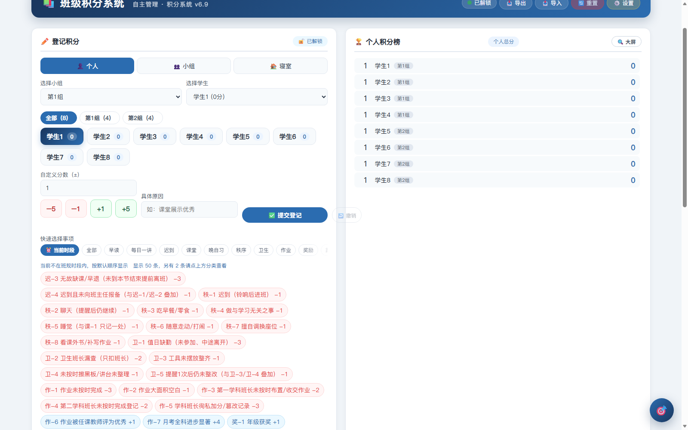
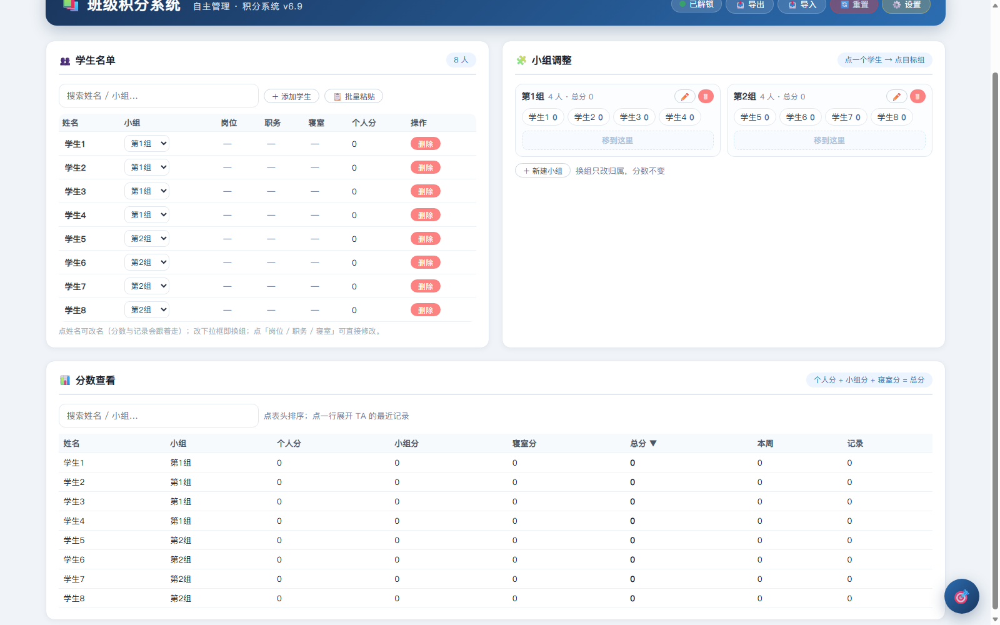
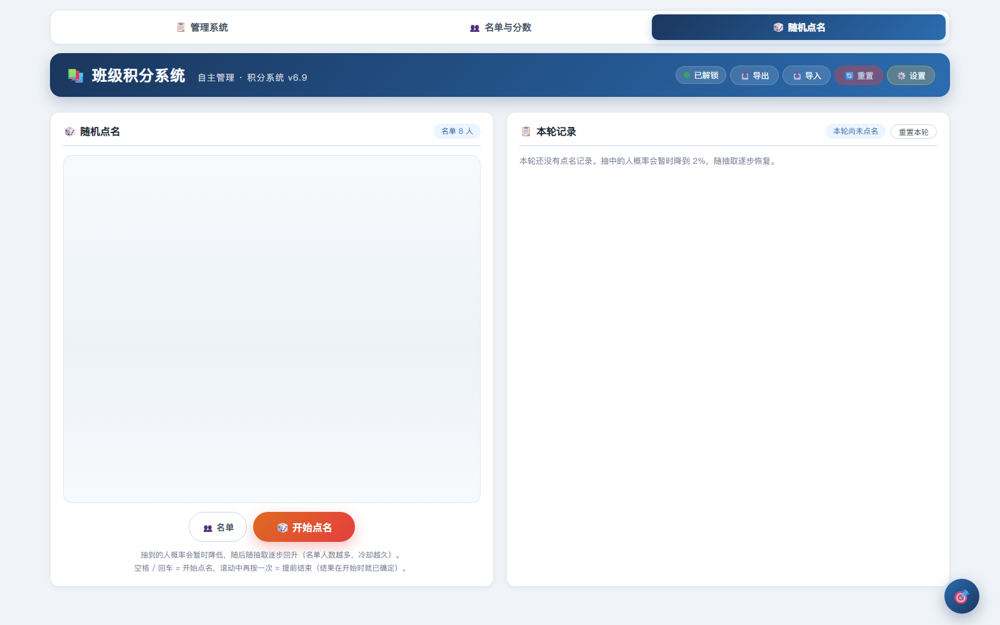

# 班级积分管理系统

一个**单文件、零依赖、双击即用**的班级积分 / 加减分系统，面向中小学班主任与班级自主管理场景。
不需要安装、不需要服务器、不需要联网：把 `.html` 拷到教室电脑双击就能用，数据存在浏览器本地。

> 本仓库是**通用纯净版**：不含任何班级的名单或真实姓名，示例数据是「学生1…学生8」占位，
> 收到后按《使用指南》第 2 节录入自己的班级即可。

## 截图

记分页（选择对象 → 记分 → 提交；条款按当前时间段自动排序）：

名单与分数页（改名单 / 调小组 / 查分数，v6.9 新增）：

随机点名（竖直轮盘 + 会话内补偿，避免连续点同一人）：

## 功能

**名单与小组**

- 「👥 名单与分数」独立页：点姓名直接改名（分数与历史记录跟着走，不会丢分）、下拉框换组、点单元格改岗位/职务/寝室
- 「＋ 添加学生」支持一次输入多个；「📋 批量粘贴」贴一整份名单，已存在的自动跳过、不覆盖分数
- 小组看板：点学生（变蓝）→ 点目标组「移到这里」即换组；可新建 / 重命名 / 删除小组；未分组的人单独列出
- 分数查看：个人分 / 小组分 / 寝室分 / 总分 / 本周 / 记录数，点表头排序、点一行展开最近记录、支持搜索

**记分**

- 个人 / 小组 / 寝室三种对象，一键切换
- 预设事项标签（可按「当前时间段」自动筛选：早读、每日一讲、课堂、晚自习、秩序、卫生、作业、奖励…），也可自定义分数与原因
- 触屏友好：学生直接显示为可点按钮，分数有 −5 / −1 / +1 / +5 步进按钮，不用调软键盘
- 提交后在按钮下方常驻「刚刚：某某 +N（原因）」，一体机上不容易怀疑没记上
- 撤销最近一笔、防连点（连点两下不会记成两笔）

**看板**

- 个人积分榜（同分并列占同名次）、各小组总分、各寝室总分
- 排行榜「大屏模式」（投屏时放大字体、双列）
- **公示栏**：本周 / 累计 × 个人 / 小组 四张表同屏（周会、家长会直接投屏）
- 小组连带折算：全组当周被扣分满 6 人次扣一次、满 12 人次再扣一次，之后每再满 4 人次再 −2（只算「应扣」，是否登记由人决定）

**随机点名**

- 内置轮盘点名：空格 / 回车开始或提前结束，也可直接点转盘区域
- 抽取时会降低已抽中者的权重、随抽取逐步回升，人数越多冷却越久，避免连点同一人
- 名单可从 txt 导入（自动识别 UTF-8 / GBK），也可手动编辑

**数据与协作**

- 数据保存在浏览器本地，可随时「导出 / 导入」JSON 备份或搬机器
- 操作记录 + 每日明细：助手运行时会自动把当天明细写成 CSV / Markdown（Excel 可直接打开）
- 局域网同步（可选）：两台设备在同一局域网时自动发现、后改的赢、断网照常记分联网自动补传
- 口令锁：可只锁写操作，不影响学生查看

## 快速开始

1. 下载 `班级积分系统.html`，双击用 Edge / Chrome 打开（Windows 10/11 自带 Edge）。
2. 右上角「⚙️ 设置」→ 把**班级名单**改成自己班的学生（支持 JSON 直接粘贴，也有「点选模式」）。
3. 开始记分。

想在上课时一键全屏呼出，再双击一次 `班级助手.exe`（可选，见下）。

## 桌面助手（可选）

`班级助手.exe` 是一个 Windows 小工具（约 50 KB，无需安装 .NET）：

- 屏幕角落常驻悬浮球：单击呼出 / 收起界面，长按展开菜单直接跳「管理系统 / 随机点名」
- 快捷键 `Ctrl+Alt+D`
- 全屏呼出（PPT 放映时也看得见）
- 开机自启动可在设置里开关（写当前用户启动项，不需要管理员权限）
- 每日明细自动落盘、局域网同步都靠它

助手与 `.html` 必须放在**同一个文件夹**里。不需要助手也能正常记分，只是少了悬浮球与自动落盘。

## 自定义

系统里的名单、小组、寝室、岗位、预设事项与分值都可以在「⚙️ 设置」里改，不写死：

- 班级名单、小组名单、寝室名单
- 岗位（组长、纪律监督员、作业统筹员…）与班级职务（班长、各科课代表…）
- 预设事项标签与分值（含「适用时间段」，让不同时段只显示相关条款）

## 技术说明

- 交付物是**单个 HTML**：CSS / JS 全部内联，用经典 `<script>`（不是 ES module），因此 `file://` 双击打开也能跑
- 零运行时依赖：没有框架、没有 CDN、没有网络请求
- 存储：`localStorage`；首次启动若检测到旧版数据会自动迁移并留备份
- 计分口径：个人总分 = 个人加减分 + 所属小组整体加减分 + 寝室分；小组总分 = 成员总分之和 + 小组整体加减分；寝室为累计分
- 代码在内部按「core（纯函数）→ app → ui → features」分层，核心计分公式有单元测试与逐位对账

## 更新记录

- **v6.9** 新增「名单与分数」独立页（改名保分 / 换组 / 批量粘贴 / 分数排序与记录展开）；CSS 分层理顺；冒烟测试默认全无头运行
- **v6.8** 公示栏（本周 / 累计 × 个人 / 小组）；提交区顺序固定；操作记录上限 2000 条；测试 102 项单元 + 76 项浏览器端到端
- **v6.7** 每日明细表头明确为「条款/原因」并含时间
- **v6.6** 点名页撑满一屏、宽屏与一体机适配、记住「刚刚」提示
- **v6.5** 修复「刚刚」显示 undefined；补「撤销」按钮位置

## 许可

MIT，见 [LICENSE](LICENSE)。可自由用于自己的班级、修改与再分发（保留版权声明即可）。
